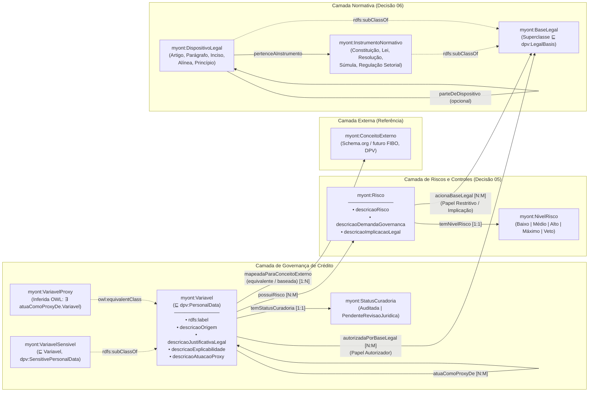
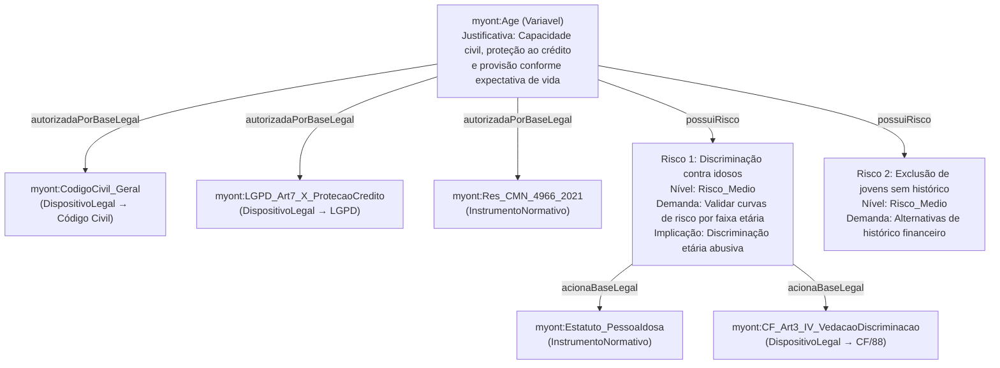
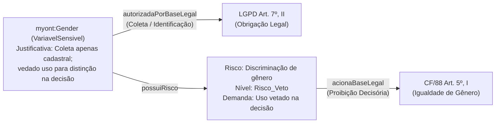

# DIAGRAMA VISUAL DA ONTOLOGIA — MyOnt V2

Este documento apresenta a estrutura visual da ontologia **MyOnt V2** ([semantic/ontologies/myont_v2.ttl](file:///home/andre/Documents/Dev/Work/Ontology/semantic/ontologies/myont_v2.ttl)), refletindo as **Decisões 05, 06 e 07** registradas em [ABOUTME.md](ABOUTME.md).

---

## 1. Modelo Conceitual (Classes e Relações Principais)

---

## 2. Exemplo Prático — Separação de Papéis Jurídicos e Múltiplos Riscos

### Caso A: `Age` (Permitida com ressalvas, múltiplos riscos distintos)

### Caso B: `Gender` (Coleta legal obrigatória vs. Vedação decisória)

---

## 3. Resumo da Evolução V1 $\to$ V2

| Aspecto | MyOnt V1 (`versions/myont_v1.ttl`) | MyOnt V2 (`myont_v2.ttl`) |
| :--- | :--- | :--- |
| **Riscos** | String única `descricaoRiscoEtico` na `Variavel` | Classe `myont:Risco` ligada por `myont:possuiRisco` (N:M) |
| **Nível de Severidade** | `NivelDemandaGovernanca` 1:1 na `Variavel` | `myont:NivelRisco` em cada `Risco` (nível da variável é derivado) |
| **Demanda de Governança & Implicação Legal** | Strings 1:1 na `Variavel` | Strings próprias dentro de cada `myont:Risco` |
| **Bases Legais** | Lista plana `BaseLegal` com propriedade única `temBaseLegal` | Superclasse `BaseLegal` $\to$ `InstrumentoNormativo` + `DispositivoLegal`; papéis separados em `autorizadaPorBaseLegal` (na `Variavel`) e `acionaBaseLegal` (no `Risco`) |
| **Origem, Justificativa, Explicabilidade, Proxy** | 7 strings na `Variavel` | 4 strings na `Variavel` (`descricaoOrigem`, `descricaoJustificativaLegal`, `descricaoExplicabilidade`, `descricaoAtuacaoProxy`) + `atuaComoProxyDe` direto |
